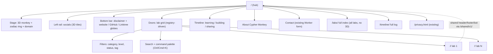
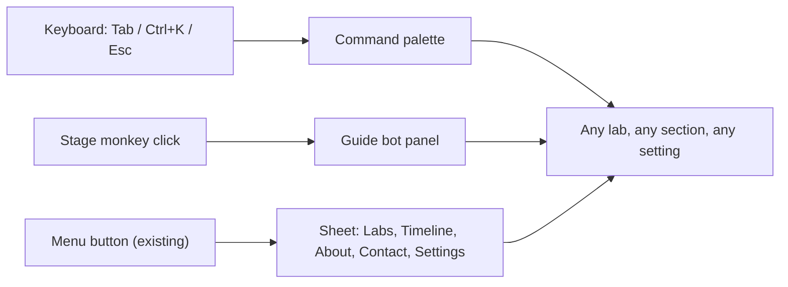

# cyphermonkeylabs.com hub: site plan

Status: **planning only**. Nothing in `_plan/` is linked from the live site, and no live file changes in this branch.
Prepared 2026-10-18 for Lucky's review. Companion files: [`LAYOUT.md`](LAYOUT.md), [`IDEAS.md`](IDEAS.md), [`REUSE_MAP.md`](REUSE_MAP.md), [`BUILD_PHASES.md`](BUILD_PHASES.md), [`mockups/`](mockups/).

Marker legend used in every file:

- **[HUMAN INPUT REQUIRED]**: only Lucky can supply this (a URL, a choice, an account).
- **[TBD]**: not decided or not known yet; do not ship a guess.
- **Verified 2026-10-18**: checked in this session by API, HTTP request, or reading the repo.

---

## 1. What exists today (verified 2026-10-18)

This plan is built on the current repo, not on a blank page.

| Fact | Value | How it was checked |
|---|---|---|
| Hosting | GitHub Pages from the root of `main`, custom domain `cyphermonkeylabs.com` (`/CNAME`), `.nojekyll` present | Repo files; `server: GitHub.com` response header |
| Cache policy | `cache-control: max-age=600` on HTML and JS | `curl -I` on `/` and `/vendor/three/three.module.js` |
| Labs on the home page | 13 labs plus Sutra Nexus (14 registry entries) and the Gemini Gems gallery | `/data/labs.json`, `/labs.json`, live `<title>` "Thirteen free labs" |
| Public repos in the `CypherMonkeyLabs` org | 16 (14 labs, the Gems gallery, `.github`, and this site repo) | `gh repo list CypherMonkeyLabs` |
| Home page first load | 23 requests, about 294 KB transferred, 7 `main` sections (`hero, trailer, labs, map, more, about, contact`) | Playwright against the live site, desktop 1440×900 and mobile 390×844 |
| 3D engine | three.js 0.186.1, vendored as one tree-shaken ESM file, 147 KB gzip on the wire | `/vendor/three/VERSION`; gzip download size |
| Existing modules worth keeping | `js/nav` (menu sheet, command palette, i18n, focus), `js/settings` (theme, sound, motion), `js/trust` (footer, contact form, Ground Rules), `js/universe` (planet scene, quality tiers, fallback), `js/cinema` (hero, drag-bot guide, audio), 10 mascot SVG poses | Repo tree |
| CI | `ci.yml` runs unit tests, manifest validation, link checks, a front-door link allowlist, a no-email scan, byte budgets, and a hex-colour rule | `.github/workflows/ci.yml` |
| Pending work | Branch `feat/lab-manifest-hooks` (unmerged) adds `lab.manifest.json` per lab, a `sync-lab.yml` workflow, and `docs/LAB-HOOKS.md`. [PR #16](https://github.com/CypherMonkeyLabs/cyphermonkeylabs.github.io/pull/16) (open) is an earlier cinematic redesign plan. | `git log`, `gh pr list` |

Before screenshots of the live site are in [`screens/before-home-desktop.jpg`](screens/before-home-desktop.jpg) and [`screens/before-home-mobile.jpg`](screens/before-home-mobile.jpg).

### Problems this plan fixes

1. **Two lab registries that disagree.** `/labs.json` and `/data/labs.json` both list 14 entries, but the ids differ for the same lab (`nice` vs `nice-cxone`, `sip` vs `sip-universe`, `genesys` vs `genesys-cloud`, `ai` vs `ai-lab`, `ba` vs `ba-lab`, `microsoft-voice` vs `microsoft-voice-cc`). The Gems gallery is in neither. At 100 labs this drift becomes bugs.
2. **The home page is hand-edited HTML.** Each new lab means editing `index.html`, the trailer copy, the guide-monkey answers ("Thirteen free labs..."), and the OG image. That does not scale past about 20.
3. **No social presence on the site.** `site.json` has 13 profile slots; 11 have empty URLs. Only Linktree and the GitHub org are linked.
4. **The front-door link allowlist** (`check-frontdoor-links.mjs`) only permits this site, the GitHub org, `github.com/cipher0x9`, and Linktree. A social rail needs that rule extended on purpose, one host at a time.
5. **Identity copy is inconsistent.** The live hero says "Lifelong student · AI enthusiast". The `cipher0x9` GitHub profile bio says "Voice/UC engineer and curious learner", which is the narrow label Lucky does not want. [HUMAN INPUT REQUIRED: update the GitHub bio; this repo cannot change it.]

---

## 2. Concept

**"The Monkeyverse front door: one living monkey, a hundred doors."**

Lucky is **Cypher Monkey (@Cypher0x9)**: a lifelong student and AI builder who is moving into AI omni-channel agents, and who learns in public by shipping free labs. The hub's job is to make that feel alive in the first second and stay useful at lab number 100.

Three ideas carry the whole design:

1. **A living centre.** The 3D CypherMonkey sits in the middle of the screen inside a zodiac ring, with `cyphermonkeylabs.com` set beneath it. It breathes, looks at the cursor, reacts to sound and scroll, and waves when a lab is opened. It is the brand, the guide (bot), and the loading indicator.
2. **Doors, not pages.** Every lab is a card (a "door") generated from one JSON registry. The same card renders in the orbit, the grid, search results, the bot's answers, and the OG image. Adding a lab is a data change, never a layout change.
3. **Learning in public, visibly.** A timeline of "what I'm learning, building, sharing" is a first-class part of the page, fed by JSON, so the site always shows motion and recency.

Tone: curious, generous, a bit playful. Copy uses "I" for Lucky and "the monkey" for the guide. Never "UC engineer" or "contact-center engineer" as a label. Voice, video, and contact centre may appear as *background* ("I came up through..."), which the live hero already does well.

Identity rules for copy (to be enforced by a CI word list, see `BUILD_PHASES.md`):

| Use | Avoid |
|---|---|
| lifelong student, AI builder, learning in public, AI omni-channel agents | "UC engineer", "contact-center engineer", any single job title as identity |
| Cypher Monkey, CypherMonkey, @Cypher0x9 | real legal name (not confirmed for public use) |
| "free labs", "practice rooms" | "official training", "certified", vendor endorsement language |

Spelling note: the Hugging Face handle is `Cypher0x9` (verified via the connected account); the personal GitHub account is `cipher0x9` (with an **i**). [HUMAN INPUT REQUIRED: confirm which spelling is the public "@" handle in copy.]

---

## 3. Information architecture



### Routes

| Route | Purpose | 3D? | Notes |
|---|---|---|---|
| `/` | Front door: stage, rails, featured doors, recent timeline | Yes, lazy | Shows at most 12 featured doors plus "See all N labs" |
| `/labs/` | Full lab index: search, filters, list or grid | No (CSS only) | Static HTML generated from the registry, so it works without JS and is crawlable |
| `/labs/<category>/` | Category landing pages | No | Generated; one per `categories.json` entry |
| `/timeline/` | Full learning log | No | Generated from `timeline.json` |
| `/<repo>/` | Each lab (separate repo, same origin) | Lab's choice | Pulls shared chrome from `/shared/v1/` |
| `/privacy.html`, `/404.html` | Existing trust pages | No | Unchanged |

Same-origin note: every lab lives under `cyphermonkeylabs.com/<repo>/`, so labs and the hub share one origin. That means shared settings (theme, motion, sound, language) and optional progress can live in `localStorage` without a server. It also means one lab's script can read another's keys, so keys must be namespaced (`cm.settings`, `cm.progress.<labId>`) and nothing sensitive is ever stored.

---

## 4. Scaling from 20 to 100+ labs

### 4.1 One registry, many views

Make `/data/labs.json` the **only** registry. Retire `/labs.json` after one release that serves both (old ids mapped to new ids in an `aliases` field, so any old deep link or script keeps working).

Draft entry (extends the existing `lab.schema.json` and the `lab.manifest.json` on `feat/lab-manifest-hooks`; new fields are marked `NEW`):

```json
{
  "schemaVersion": 2,
  "id": "python-lab",
  "aliases": ["python"],
  "kind": "lab",
  "title": "Python Lab",
  "shortTitle": "Python",
  "tagline": "Learn Python in the browser, from print to projects.",
  "summary": "80 to 320 characters, as today.",
  "category": "coding",
  "tags": ["python", "numpy", "pandas"],
  "level": "starter",
  "status": "live",
  "url": "https://cyphermonkeylabs.com/python-lab-free-university-mesmerizing/",
  "repo": "https://github.com/CypherMonkeyLabs/python-lab-free-university-mesmerizing",
  "icon": "spark",
  "theme": { "accent": "#ffd166", "glyph": "spark", "scene": "orbit" },
  "art": { "card": "/assets/labart/python-lab.svg", "alt": "[TBD per lab]" },
  "stats": { "lessons": null, "quizQuestions": null },
  "launchedAt": "2026-10-17",
  "updatedAt": "2026-10-17",
  "lastVerified": "2026-10-17",
  "featured": false,
  "order": 130,
  "sources": [],
  "vendorsReferenced": []
}
```

Rules:

- `id` is stable forever; renames go into `aliases`.
- `stats` stay `null` until a number has been counted from the lab repo by a script. No hand-typed counts (matches the existing "counts that I have not checked myself stay out of the copy" rule in `data/author.json`).
- `art.card` must be an asset made for this site or one with a recorded licence (see section 9).
- `theme.accent` is validated for contrast against both dark and light backgrounds in CI.

### 4.2 Labs add themselves (via PR, never straight to `main`)

Reuse the unmerged `feat/lab-manifest-hooks` design, which already solves this:

```text
lab repo push
  -> notify-site.yml (in the lab repo)
  -> repository_dispatch "lab-updated" to the hub
  -> sync-lab.yml: fetch lab.manifest.json at that SHA, validate, upsert /data/labs.json
  -> opens PR bot/lab-<id>  -> CI (validate, link check, screenshot diff)  -> Lucky merges
nightly reconcile: every org repo with topic "cml-lab" is compared with the registry; drift opens one PR
```

What this plan adds on top:

- A **build step that renders HTML from the registry** (`scripts/build-hub.mjs`, zero dependencies, Node 22). It writes the door cards, `/labs/`, category pages, `sitemap.xml`, the guide-bot's answer data, and the "N free labs" count between `<!-- cm:generated -->` markers in committed files. CI fails if the committed output differs from a fresh build. This keeps the current "Pages serves the repo root" model (no change to how the site ships, which `docs/ROLLBACK.md` warns about).
- **Lab count is never typed.** Title, OG text, trailer caption, and bot answers read the count from the registry at build time.
- A **new-lab issue form** already exists (`.github/ISSUE_TEMPLATE/new-lab.yml`); it stays as the human path.
- One-time setup (GitHub App, secrets, `cml-lab` topic) is listed in `docs/LAB-HOOKS.md` on that branch. [HUMAN INPUT REQUIRED: Lucky creates the App and secrets; nothing here creates secrets.]

### 4.3 Search and categories

| Scale | Approach | Cost |
|---|---|---|
| Up to about 60 labs | Search the registry in memory (title, tags, tagline) with a small fuzzy matcher. The existing `js/nav/palette.js` command palette becomes the search box. | 0 extra requests |
| 60 to 300 labs, or searching lesson titles inside labs | Build a static index at build time. Candidates: MiniSearch (MIT) for a JSON index, or Pagefind (MIT) which indexes built HTML and loads chunks on demand. | One index file, loaded on first keystroke |
| Cross-lab lesson search (thousands of rooms) | Each lab publishes `/<repo>/search-index.json`; Pagefind multisite or a merged index built nightly | Lazy, per-query chunks |

Categories come from `data/categories.json`, which today has 6 entries; `site.json` has a different list of 4. Merge into one list. Proposed set (draft, [HUMAN INPUT REQUIRED] to approve names):

| id | Label | Current labs (by today's registry) |
|---|---|---|
| `agents` | AI agents and omni-channel | none yet; this is where Lucky is heading |
| `ai` | AI foundations | AI Lab |
| `coding` | Coding | Python Lab |
| `contact-center` | Contact centre platforms | Amazon Connect, Five9, Genesys Cloud, NICE CXone, Zoom/Talkdesk/Avaya |
| `voice-video` | Voice, video and collaboration | UC Lab, Microsoft Voice, Webex |
| `protocols` | Protocols and APIs | SIP Universe, CPaaS |
| `business` | Business analysis | BA Lab |
| `texts-languages` | Texts and languages | Sutra Nexus |
| `galleries` | Galleries and tools | Gemini Gems gallery |

Filters on `/labs/`: category, level (`starter`, `navigator`, `deep-dive`), status (`live`, `beta`, `coming-soon`), and "recently updated". Filter state lives in the URL query (`/labs/?cat=protocols&level=starter`) so it can be shared.

### 4.4 Shared header, bot, and footer for every lab

Ship shared chrome as versioned, framework-free Web Components from the hub:

```html
<!-- in any lab, same origin -->
<script type="module" src="/shared/v1/cm-chrome.js"></script>
<cm-header lab="python-lab"></cm-header>
...
<cm-guide lab="python-lab"></cm-guide>
<cm-footer></cm-footer>
```

| Component | Built from (existing) | Does |
|---|---|---|
| `<cm-header>` | `js/nav` (sheet, palette, i18n, focus trap) | Logo monkey, "All labs" palette, theme/motion/sound settings, breadcrumb to the hub |
| `<cm-guide>` | `js/cinema/dragbot.js` | Draggable monkey bot; answers from the registry and the current lab's own FAQ JSON; no third-party call by default |
| `<cm-footer>` | `js/trust/footer.js` | Ground Rules disclaimer, licences, trademark line, the three globe links |
| `<cm-social-rail>` | new | Same social data as the hub's left rail, compact |

Versioning: `/shared/v1/` is additive only. Breaking changes go to `/shared/v2/` and labs move when ready. Each component renders its light-DOM fallback (plain links) before JS, so a lab never shows an empty header. Budget: all four components together ≤ 25 KB gzip.

### 4.5 Theming per lab

- Design tokens stay in `css/tokens.css` (the hex rule already enforces this).
- Each lab sets `--cm-accent` (from `theme.accent`) and optional `--cm-scene` on `<html>`; shared components read only tokens, never raw colours.
- Site themes that exist today (`canopy`, `market`, `ice`, `amber`, `paper`) remain the user-level choice; the lab accent layers on top.
- CI checks every accent for WCAG AA contrast (4.5:1 for text) against the dark and the paper theme. Accents that fail get a darker "ink" variant generated automatically.

---

## 5. Navigation model



1. **Top header** (exists): logo, a few anchors, sound toggle, large Menu button. Unchanged except a visible "Search labs ⌘K" pill.
2. **Command palette** (exists in `js/nav/palette.js`): becomes the universal finder for labs, timeline entries, and actions ("switch to light theme", "reduce motion").
3. **Left social rail**: secondary, never blocks content; collapses to a single "Follow" button on mobile (see `LAYOUT.md`).
4. **Stage**: clicking the monkey opens the guide bot; scrolling past the stage turns it into a small docked monkey (the existing drag-bot pattern).
5. **Doors**: each card has one primary link (open lab) and one secondary (source on GitHub). Cards are real `<a>` elements in HTML, so they work without JS.
6. **Bottom bar**: always reachable at the end of the page; on desktop it is a slim fixed bar that hides while scrolling down and returns when scrolling up.
7. **Inside a lab**: `<cm-header>` gives "Back to all labs" and the same palette, so a visitor can jump lab-to-lab without returning to `/`.

---

## 6. Performance budget

Numbers extend `docs/PERFORMANCE-BUDGETS.md`; none of its limits are raised. The current live page (294 KB, 23 requests) already fits inside them.

| Item | Limit (gzip unless noted) | Load timing |
|---|---|---|
| HTML for `/` | ≤ 30 KB | First |
| CSS incl. critical | ≤ 35 KB | First |
| Initial JS (settings, nav, palette, rail, bottom bar) | ≤ 50 KB | First |
| Stage poster (SVG monkey + ring, inline) | ≤ 14 KB | First, this is the LCP element candidate |
| three.js core (current vendored file) | 147 KB measured | After LCP, only if WebGL, not save-data, not reduced motion |
| Monkey model (GLB, meshopt-compressed, KTX2 textures) | ≤ 250 KB file | After three.js, on idle |
| Social tiles + globes | ≤ 12 KB (one SVG sprite), 3D effect in CSS | First |
| Effects shaders (bloom, particles) | ≤ 20 KB | With the scene |
| Total before interaction | ≤ 450 KB mobile, ≤ 900 KB desktop after scene | |
| Requests before LCP | ≤ 15 | |
| LCP / INP / CLS (lab) | ≤ 2.5 s / ≤ 200 ms / ≤ 0.05 | Lighthouse CI on every PR |

Rules:

- The 3D monkey **never** blocks first paint: the inline SVG poster is the LCP element, the WebGL canvas fades in over it.
- Quality tiers (already in `js/universe/quality.js`): `high` (bloom + particles), `medium` (no bloom), `low` (poster SVG with CSS parallax). Chosen by GPU tier, `devicePixelRatio`, `navigator.connection.saveData`, and a frame-time probe in the first 2 s.
- The scene pauses when off screen (`IntersectionObserver`) or the tab is hidden.
- Adding a GLTF loader means extending the vendored three.js bundle; measure that before choosing GLB over a procedural (code-built) monkey. A procedural low-poly monkey built from primitives adds roughly 0 KB of asset weight and is the fallback plan if the GLB path busts the budget.
- At 100 labs, the front door still renders at most 12 doors; the rest are on `/labs/`. Card art is lazy (`loading="lazy"`, fixed `width`/`height`, AVIF/WebP with SVG fallback).

---

## 7. Accessibility

Target WCAG 2.2 AA. Concrete requirements:

1. **Everything works without the 3D.** The stage is decorative (`aria-hidden="true"` on the canvas). The headline, domain name, and all links are real HTML.
2. **Reduced motion**: `prefers-reduced-motion` or the site motion setting stops idle animation, particles, parallax, and auto-rotate; the monkey becomes the static poster. Already the pattern in `js/cinema/hero.js`.
3. **No autoplay sound.** Audio is off by default and created only after a click (current `js/cinema/audio.js` behaviour).
4. **Targets** ≥ 48 px (already the site rule) for social tiles, globes, and cards.
5. **Social rail semantics**: `<nav aria-label="Cypher Monkey on social media">` with a list of links; each link's accessible name is "Cypher Monkey on X (opens new tab)", not just the icon. Unknown URLs are **not rendered as links** at all.
6. **Keyboard**: logical tab order (header → stage CTA → doors → timeline → rail → bottom bar), visible focus rings, `Esc` closes palette and bot, focus returns to the trigger.
7. **Screen readers**: the timeline is an ordered list with `<time datetime>`; status chips have text, not colour only.
8. **Zoom and reflow**: no horizontal scroll at 320 px or 400% zoom; the rail and bottom bar reflow into the page flow on narrow screens.
9. **Forced colours / high contrast**: borders on tiles and cards (already in `css/trust.css` patterns).
10. **Language**: `lang` on greetings (the existing 14-language greeting list in `site.json`) and `dir="rtl"` for Arabic.
11. **Automated checks**: axe-core in Playwright on `/`, `/labs/`, `/timeline/`, and two sample labs; fail on serious or critical issues.

---

## 8. Security and privacy (kept from today)

- Content Security Policy stays strict (`default-src 'self'`). Each new external host (for example, a social host for an image) must be added deliberately; plain outbound links do not need CSP changes.
- No trackers, no third-party fonts, no third-party embeds on `/`. Video embeds (YouTube etc.) only as click-to-load facades.
- No email addresses in HTML (existing `check-no-email.mjs`).
- **LinkedIn stays off the public site.** Add `linkedin.com` to a deny-list in the link checker so it cannot slip in.
- The contact Worker and Turnstile stay as they are.

---

## 9. Licence-safe asset policy

| Class | Rule |
|---|---|
| Code (MIT, Apache-2.0, BSD, ISC, Zlib, Unlicense, CC0) | May be adapted. Keep the copyright notice in a `THIRD_PARTY_NOTICES.md` and in the file header. Apache-2.0: also keep any NOTICE file. |
| Copyleft code (GPL, AGPL, MPL, CC-BY-SA) | Do not copy into the site without Lucky's explicit decision. AGPL (for example, `hydra-synth/hydra`) is link-only. MPL-2.0 tools used only in CI (axe-core) are fine because they are not shipped. |
| "NOASSERTION" or no licence file | **Link-only.** Treat as all rights reserved until the repo shows a licence. |
| UNKNOWN (most HF Spaces, CodePen pens, Codrops demos without a LICENSE, AI Studio apps) | **Link-only / inspiration only.** Re-implement the idea from scratch; do not paste code. |
| Custom licences (GSAP "Standard no-charge", Gemini API Additional Terms) | Allowed only after Lucky reads the terms; record the decision in the notices file. |
| Brand logos (X, Telegram, Instagram, etc.) | Use the platform's official glyph unmodified, or the Simple Icons path (CC0 data; trademark still belongs to the brand). Put it **on** our own 3D tile; do not extrude, recolour, or distort the logo itself. Check each brand's guideline before launch: [TBD per platform]. |
| Vendor product logos (Cisco, AWS, Genesys, etc.) | Never. Existing rule in `docs/TRADEMARKS.md`. |
| Emoji art | Fluent Emoji (MIT, `microsoft/fluentui-emoji`, includes 3D-style PNGs), Noto Emoji (OFL-1.1 font, Apache-2.0 images), Twemoji (`jdecked/twemoji`: code MIT, graphics CC BY 4.0, so attribution is required). OpenMoji is CC BY-SA 4.0 (share-alike; avoid for the brand mark). |
| The CypherMonkey mascot and zodiac mark | Original art owned by Lucky; excluded from the CC content licence (existing rule in `docs/LICENSE-CONTENT.md`). |
| AI-generated art | Allowed if made by Lucky with a tool whose terms grant him the output; record tool and date in the asset's sidecar `.json`. |
| Fonts | OFL only, self-hosted (current practice). |

Every asset under `assets/` gets a sidecar or a row in `assets/CREDITS.json`: `{ file, source, licence, author, url, addedOn }`. CI fails if an asset has no row.

---

## 10. Decisions Lucky needs to make

| # | Decision | Options | Recommendation |
|---|---|---|---|
| 1 | Timeline placement | Top strip / right column / scroll story (see `LAYOUT.md` §5) | Right column on desktop, collapsing to a strip on mobile |
| 2 | Monkey: modelled GLB or procedural | GLB from Blender, procedural from code, or 2.5D layered SVG | Start 2.5D SVG (day 1), then procedural three.js (day 3), GLB only if he has a model |
| 3 | Zodiac mark | Chinese zodiac Monkey (猴, earthly branch 申), emoji 🐒, or his own glyph | [HUMAN INPUT REQUIRED] |
| 4 | Social URLs | 12 Linktree handles + dev.to + HF | [HUMAN INPUT REQUIRED], see `LAYOUT.md` §2 |
| 5 | Category names | §4.3 table | [HUMAN INPUT REQUIRED] |
| 6 | Merge `feat/lab-manifest-hooks` | Merge first, or rebase into the new build | Rebase it in on day 2 of `BUILD_PHASES.md` |
| 7 | PR #16 | Close as superseded, or keep both | Keep open until this plan is approved, then close |
| 8 | Bot backend | Static answers only, or an optional LLM endpoint | Static by default; any model call goes through a Worker he controls and is opt-in |
